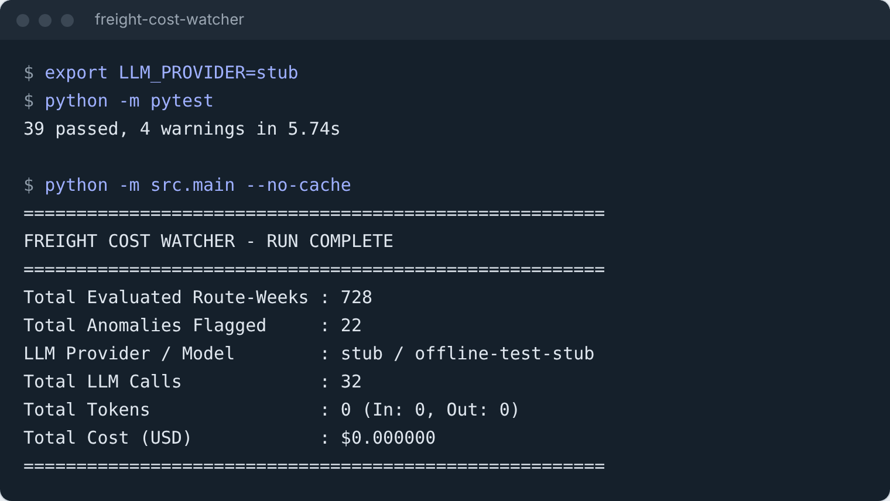

# Freight Cost Watcher

[](https://github.com/nickittime/freight-cost-watcher/actions/workflows/tests.yml)


Flags unusual road-freight cost rises across 7 Indian shipping corridors, then checks each flag against operations notes before a person reviews it.

- **Detects:** sudden rate spikes, and slow "cost creep" that a fixed threshold misses
- **Verifies:** an LLM proposes a reason for each flag, and deterministic Python checks decide whether to accept it
- **Proves it:** 39 offline unit tests, an evaluation harness, and a run-3-times reproducibility check

---

## What it does

1. Reads 2,940 shipment records and computes weekly cost per tonne-km for 7 routes over 104 weeks (728 route-weeks).
2. Compares every route-week with two baselines: the route's own last 8 weeks, and same-week routes of similar length.
3. Flags acute spikes (10% or more above the route's own history) and sustained creep (20% or more above peer routes). A hysteresis rule keeps creep flags from flickering on and off.
4. Sends only the 22 flagged candidates (97% of route-weeks pruned) to a verifier. It retrieves context notes from ChromaDB, and an LLM proposes which note explains the rise.
5. Runs every proposed reason through five rule-based checks: route scope, date window, cause direction, nationwide peer gap and magnitude ceiling. If a reason fails, the week stays flagged as "Unexplained" for human review.
6. Writes `outputs/flagged_output.csv`, a full weekly analysis, an LLM audit log and a token-cost log.

## Why I built it

<!-- Edit into your own words if you like. -->
A fixed price threshold catches big jumps in freight rates, but it misses a route that gets slightly more expensive every week. It also can't tell you whether a jump has a known cause, like a flood or a festival surcharge. I wanted a system that finds both kinds of rise and lets an LLM suggest the cause, without letting it make one up.

## Tech

| Area | Used |
|---|---|
| Language | Python 3.11+ |
| Data | pandas, NumPy |
| Config and validation | pydantic, pydantic-settings |
| Retrieval | ChromaDB |
| LLM | Groq API (`openai/gpt-oss-20b`, temperature 0, seed 42); Gemini supported via `google-genai` |
| Testing and quality | pytest, pytest-cov, ruff |
| Packaging | Docker (multi-stage, non-root) |

## Run it

### 1. Offline, with no API key

Uses a rule-based stub instead of the LLM. Good for a first look and for tests.

```bash
git clone https://github.com/nickittime/freight-cost-watcher.git
cd freight-cost-watcher
python -m venv venv
source venv/bin/activate            # Windows: venv\Scripts\activate
pip install -e ".[dev]"

export LLM_PROVIDER=stub            # Windows PowerShell: $env:LLM_PROVIDER="stub"
python -m pytest                    # 39 tests
python -m src.evaluation.eval_harness
python -m src.main --no-cache       # full pipeline; stub verdicts, not LLM verdicts
```

### 2. With the real LLM verifier

```bash
cp .env.example .env                # Windows: copy .env.example .env
# open .env and set GROQ_API_KEY
python -m src.main --no-cache
python -m src.evaluation.repro_check    # 3 cold runs, compares output hashes
python -m src.main --ask "Why did Chennai-Bangalore get pricier in February and March 2025?"
```

## Output

Offline run (`LLM_PROVIDER=stub`):

```text
=======================================================
FREIGHT COST WATCHER - RUN COMPLETE
=======================================================
Total Evaluated Route-Weeks : 728
Total Anomalies Flagged     : 22
LLM Provider / Model        : stub / offline-test-stub
Total LLM Calls             : 32
Total Tokens                : 0 (In: 0, Out: 0)
Total Cost (USD)            : $0.000000
=======================================================
```

Three rows from `outputs/flagged_output.csv` (Groq run, reasons shortened):

| Route | Week of | ₹ per tonne-km | vs own history | vs similar routes | Flagged | Reason |
|---|---|---|---|---|---|---|
| Ahmedabad-Mumbai | 2025-01-20 | 3.29 | +29.5% | +22.5% | No (justified) | Matches note N002: festival-week surcharge on this corridor |
| Chennai-Bangalore | 2025-03-10 | 3.57 | +22.1% | +33.8% | Yes | Flood note N001 ended 2025-03-08, so it can't explain this week |
| Mumbai-Pune | 2025-12-22 | 4.49 | +5.7% | +38.9% | Yes | Creep: small rise vs own history, large gap vs peers; no note explains it |



### Results (from `outputs/eval_report.json` and `outputs/token_cost_log.json`)

- **Detector recall:** 9 of 9 planted benchmark events caught
- **Verifier accuracy:** 22 of 22 candidates; citation precision 22 of 22
- **Adversarial traps:** all 4 counterfactual scenarios blocked by the guardrails
- **Reproducibility:** output CSV identical (same SHA-256) across 3 cold runs
- **Cost:** 19 LLM calls, 20,611 tokens, about $0.0036 for a full run

---

## How it works

```
shipment_records.csv (2,940 shipments)
        │
        ▼
Stage 1  Validation and ratio-of-sums aggregation   → 7 routes × 104 weeks = 728 route-weeks
        │
        ▼
Stage 2  Baselines: own history (8-week deque) + leave-one-out peer routes
        │
        ▼
Stage 3  Anomaly gate: spike ≥ 10%, creep 20% entry / 15% keep   → 22 candidates
        │                                         context_notes.csv (10 notes)
        ▼                                                  │
Stage 4  Grounded verifier: ChromaDB retrieval + LLM (T=0) ◄┘
        │
        ▼
Stage 5  Deterministic guardrails: route, window, direction, peer gap, magnitude
        │
        ▼
outputs/flagged_output.csv · token_cost_log.json · interactive --ask CLI
```

<details>
<summary><b>Baselines</b></summary>

- **Ratio of sums.** Weekly cost per tonne-km is total freight cost divided by total (quantity × distance) for the route-week. Averaging per-shipment ratios would over-weight light loads.
- **Own history.** A calendar-bounded deque of up to 8 prior Mondays (56 days) per route. It uses only earlier weeks, so there is no look-ahead leakage. Routes with fewer than 8 prior weeks average what they have, and a route's first week is marked `N/A (no prior history)`.
- **Peer routes, leave one out.** For each week and distance class (Short, Medium, Long), the average of the other routes in that class, computed in O(1) per row from bucket totals.

</details>

<details>
<summary><b>Hysteresis rules and threshold sensitivity</b></summary>

On Mumbai-Pune in late 2025, rates rose gradually from about ₹3.41 to ₹4.49 per tonne-km. The 8-week baseline rose with them, so the own-history gap stayed at +5% to +9% while the peer gap reached +38.9%.

1. **Spike:** `vs_own_pct >= 10%`
2. **Creep entry:** `vs_peer_pct >= 20%` and `vs_own_pct >= 5%`
3. **Creep keep:** stays flagged while `vs_peer_pct >= 15%` and `vs_own_pct > 0%`

| Spike | Creep entry | Min own rise | Keep | Candidates |
|:---:|:---:|:---:|:---:|:---:|
| **10%** | **20%** | **5%** | **15%** | **22 (chosen)** |
| 8% | 20% | 5% | 15% | 23 |
| 12% | 20% | 5% | 15% | 21 |
| 10% | 18% | 4% | 12% | 22 |
| 10% | 22% | 6% | 15% | 19 |

</details>

<details>
<summary><b>Guardrails</b></summary>

1. **Route scope:** the note must apply to this route or to "All Routes". Distractor note N004 is blocked.
2. **Date window:** the N001 flood (Feb 24 to Mar 8) explains weeks 2025-02-24 and 2025-03-03 only. Route notes with no end date (N002) count for 1 week.
3. **Cause direction:** notes about absorbed costs, routine maintenance or normal operations can't justify a rise.
4. **Nationwide peer gap:** a nationwide diesel rise (N003) affects all routes, so it can't explain a route that is more than 10% above its peers.
5. **Magnitude ceiling:** Mumbai-Delhi rose 11.6% on 2025-05-12, above N003's stated 5 to 7% plus 3% tolerance, so it stays flagged.

</details>

<details>
<summary><b>Assumptions, trade-offs, future work</b></summary>

- Routes are directional (Origin-Destination); weeks are keyed by their Monday.
- When evidence is unclear, a week stays flagged. A false alarm costs less than a false justification.
- Reasons are built from the verified checks rather than copied from LLM text. That gives up some wording variety in exchange for stable, non-contradictory output.
- Retrieval always includes every note scoped to the route or "All Routes", ranked by date proximity, because dense search alone can miss short time-bound notes.
- **Next:** seasonal indexing across years, separating carrier rate changes from corridor-wide inflation, and async batched verification for larger datasets.

</details>

## What I learned

<!-- These come straight from the design decisions above. Rewrite them in your own words. -->

- A trailing baseline drifts upward with slow cost creep, so it can't catch creep on its own. Comparing against peer routes in the same week did.
- Separate entry and exit thresholds (hysteresis) stopped flags flickering between consecutive weeks.
- LLM output needs a deterministic gate. Checking scope, dates and magnitude in plain Python caught every planted trap.
- Fixing temperature and seed, and building reasons from checks rather than free text, made runs reproducible byte for byte.
